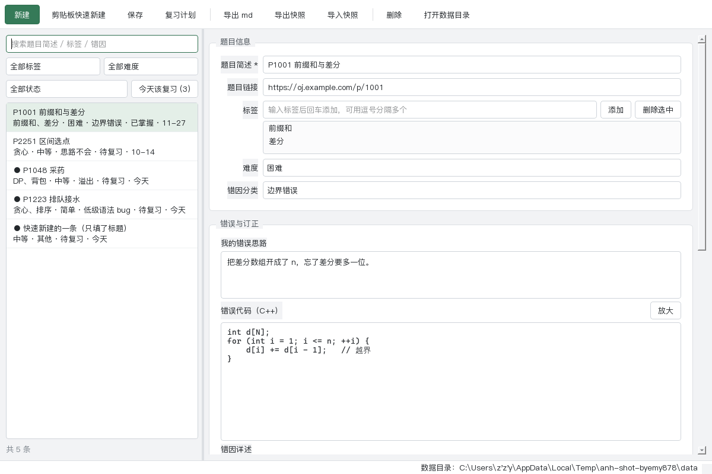

# AlgorithmNoteHelper 算法错题助手

面向蓝桥杯 C/C++ 刷题的**本地**错题管理工具：录入错题 → 记录错误思路与 AC 代码 →
用 SM-2 间隔重复安排复习 → 导出 Markdown，或把整套题解打包分享给同学。

纯本地运行：不联网、不装数据库、不需要账号。数据就是几个 Markdown 文件加一个 JSON 索引，
随时可以打开看、可以拷走。



## 功能

- **只填标题就能录**：题目简述是唯一必填字段，难度与错因有默认值、可事后补
- **剪贴板快速新建**（`Ctrl+Shift+N`）：标题取自剪贴板首行（是链接就顺手填进题目链接），两次按键完成录入
- **三档复习评分**（忘记 / 困难 / 轻松）驱动 SM-2：自动算下次复习日期，自动生成"今天该复习"队列
  （`待复习` 是**状态**口径、`今天该复习` 是**队列**口径，两者刻意分开；列表里直接显示下次日期）
- **"已掌握"不是终点**：间隔拉长到 30 天以上进入已掌握，但逾期一周仍会回到队列，避免长间隔段被截断
- 按关键词 / 标签 / 难度 / 复习状态筛选，一键筛出今天该复习的
- 导出单条错题为 Markdown，front-matter 齐全，可直接丢进 Typora / Obsidian
- **单文件全量快照**：一个 JSON 含索引与全部正文，可备份、可恢复、**可与同学互导题解**
- 数据安全：原子写、保存前轮转备份、单实例锁、导入前校验并自动备份现场

## 运行环境

Python 3.10+（开发用的是 3.12）与 PySide6。

```
pip install -r requirements.txt
python main.py
```

或者直接用打包好的 exe，见 `FIRST_RUN.md`。

## 数据放在哪

程序按以下顺序选择数据目录，并在窗口底部状态栏显示最终位置：

1. 环境变量 `ANH_DATA_DIR`（若设置）
2. 程序目录下的 `data/`（若可写）→ **便携模式：解压即用，数据跟着文件夹走**
3. `%APPDATA%\AlgorithmNoteHelper\`（程序目录不可写时，例如装在 `C:\Program Files\`）

```
data/
├── index.json      索引：题目简述、标签、难度、错因分类、复习状态、SM-2 参数
├── notes/<id>.md   正文：错误思路、错误代码、错因详述、正确思路、AC 代码、复盘总结
└── backups/        快照与索引备份（自动备份只保留最近 10 份，手动导出的快照不会被删）
```

> ⚠️ **`notes/` 下的 md 是应用的数据文件，请不要用 Typora / Obsidian 直接编辑。**
> 应用保存时会整篇重新生成，外部修改会被覆盖。要外部编辑，请用「导出 md」导一份副本到别的目录。

## 使用

1. **新建**：`Ctrl+N` 开一条空白错题；或 `Ctrl+Shift+N` 从剪贴板快速新建
2. **保存**：`Ctrl+S`。保存后**立即进入「今天该复习」队列**
3. **复习**：点「完成复习」选忘记 / 困难 / 轻松，算法自动安排下次
4. **每周复盘**：点列表上方的「今天该复习 (N)」
5. **分享**：「导出快照」得到一个 JSON 发给同学；对方用「导入快照」导入。
   遇到同一条错题时可以选**跳过 / 覆盖 / 收为副本**

## 打包

在 PowerShell 里运行（PowerShell 7 用 `pwsh`，Windows PowerShell 用 `powershell`）：

```
powershell -File tools/build.ps1
```

产物在 `dist/AlgorithmNoteHelper/`，整个目录拷给别人即可运行；脚本会把 `README.md` 与
`FIRST_RUN.md` 一并复制进去，并在结尾跑一次分发件自检、报告最终体积。
用 onedir 而不是 onefile：onefile 每次启动都要把自己解压到临时目录，启动明显更慢。

## 开发

```
python -m pytest             # 113 项测试
python tools/shoot.py        # 离屏渲染主窗口截图到 .shots/（视觉自查用）
python main.py --self-check   # 不启动界面，检查数据目录与一致性
```

分层约定：**只有 `main.py` 与 `ui/` 允许 import Qt**，`models` / `paths` / `srs` / `storage` /
`services` 是纯 Python。所以数据层与业务层可以直接用 pytest 测，不需要 GUI 环境。

## 工程决策

这一节记录"为什么这么做"。大部分取舍都有具体理由，而不是取默认值。

### 为什么用 PySide6 而不是 PyQt6

两者 API 几乎一致，但 PySide6 是 LGPL，PyQt6 是 GPL / 商业双许可。这个项目要打包成 exe
分发给同学，用 PyQt6 会带来 GPL 传染的顾虑。对一个要分发的小工具，许可证不是细节。

### 为什么自己写 SM-2，而不是用现成的间隔重复库

算法本体只有几十行（`srs.py`），零依赖、可读、可测；引第三方库反而增加打包体积与行为
不确定性。而且本项目只需要三档评分映射到 SM-2 的 quality，定制点很小，库带来的抽象成本
大于收益。

`srs.py` 刻意不认识 `review_status`：它只处理调度参数与日期。"是否该复习"是"状态 + 排期"的
组合判断，落在 `services.py`。守住这条边界，算法层就是纯函数，单测不需要文件系统。

### 为什么复习状态只有两态

最初的设计有三态：`todo`（未复习）/ `due`（待复习）/ `mastered`（已掌握）。
问题是 `todo` 的定义就是 `last_review_time == null` —— 这是**可派生**的事实，存成状态字段
等于制造了第二个真相来源。而它真的引发了一个功能漏洞：

队列判定是 `status == due 且 next_review <= 今天`，而新建条目是 `todo`；`todo → due`
又只能靠用户主动评分触发。结果就是：

> **一条新建后再没打开过的错题，永远不会出现在任何"待复习"队列里。**

而"记了错题就忘了复习"恰恰是错题本最常见的死法 —— 这个 bug 会精确击中最需要它的场景。

现在只有 `due` / `mastered` 两态，新建即为 `due`、`next_review = 创建日`，保存后立刻入队；
"未复习"改成由 `last_review_time` 派生的筛选。

至于为什么仍然**存储** `review_status`：`mastered` 本可由 `srs.interval >= 30` 推导，
存储它的唯一理由是允许手动覆盖。所以约定：这个字段的增量语义只有"手动覆盖"。

### 为什么"已掌握"不是终态

按实际算法推算（间隔的乘法使用**更新前**的 ease）："轻松"路径的间隔是 `1 → 6 → 16 → 45`，
第 4 次评分跨过 30 天阈值；"困难"路径是 `1 → 6 → 13 → 27 → 52`，第 5 次跨过。

如果 `mastered` 是终态、此后不再复习，SM-2 最有价值的长间隔段（30 → 90 → 180 天）恰好被
截断，"已掌握"实际只等于"三到七周内没忘" —— 与间隔重复的立意相反。
所以 `mastered` 表示"已进入长间隔"，仍继续调度，只是逾期超过 **7 天宽限期**才重新入队：
既不打扰，也不丢掉长期复习。

### 数据一致性是怎么保证的

这个工具的全部价值是那些正文（错因分析、AC 代码），所以对"丢数据"的处理比较偏执：

| 措施 | 防的是 |
| :-- | :-- |
| 原子写（同目录临时文件 → `fsync` → `os.replace`） | 写到一半崩溃导致索引/正文损坏 |
| 每次保存前轮转备份 `index.json`（保留最近 10 份） | 误操作覆盖、程序 bug 写坏索引 |
| 删除前先把该条（含正文）单独存一份快照 | 误删 |
| 单实例锁（`QLockFile`） | 双击两次开两个进程、退出时互相覆盖索引 |
| 数据目录不可写时自动回落 `%APPDATA%` | 装在 `Program Files` 里保存直接失败 |
| 导入/恢复前校验每个 `id` 是合法 uuid4 | `id` 直接用作文件名，不校验就能路径穿越 |
| 校验失败即**整份拒绝**快照 | 写进半个数据目录，比拒绝更难收拾 |
| 全项目只有一个"取今天"的函数，且取本地日期 | UTC 与本地日期混用导致差一天（UTC+8 下 08:00 前） |

### 为什么快照要内联正文

最初的"备份"只导出 `index.json`，不含 `notes/*.md`。那样恢复出来的索引条目在磁盘上没有
对应正文，会直接产生"失联条目"，而正文才是这个工具的全部价值 —— **不含正文的备份没有意义。**

改成单文件全量快照后有个附带收益：它变成了一个**可分享的题解包**。同学之间交换一个 JSON
就能互相导入错因分析，不必交换整个笔记库、插件配置与版本。这也回答了"为什么不直接用
Obsidian + Dataview"：固定字段带来的低录入成本，加上单文件互导，是通用笔记方案做起来
很别扭的两件事。

快照里存的是**结构化的小节内容**而不是 md 原文，恢复时按模板重新生成，这样模板将来升级了，
旧快照依然能恢复。

### 为控制范围做的取舍

- **砍掉控制台版阶段**：原计划先用 CLI 验证数据层，但控制台里粘贴大段 AC 代码体验极差，
  容易在 CLI 交互上耗掉一周。改成"只写数据层 + pytest，用测试当界面"，省下几天，且不损害原目标。
- **砍掉开工前的多方案视觉探索**：原计划先出 3 个布局概念再写 brief。对一个个人工具，
  这是设计工作而非编码工作，最大的风险是卡在布局纠结上、两周过去还没有能跑的东西。
  改成"先做一个干净克制的布局，跑通全部功能后统一精修一次，每轮只修 1–3 个最刺眼的问题"。
  **砍掉的是流程，不是标准。**
- **只保留一个必填字段**：太重的录入表单会让人在"刚 WA 完、想赶紧看下一题"时不打开工具，
  而这个工具最大的失败风险不是技术，是没人愿意录。
- **不做 UI 自动化测试**：交互与视觉的成本高、收益低，靠手工用例与离屏截图自查覆盖；
  只保留一个界面接线的冒烟测试（窗口能构造、动作能触发、空标题能被拦住）。

## 已知限制

- 没有 C++ 语法高亮（`QSyntaxHighlighter` 可随时接入，列入 V0.2）
- 搜索只覆盖索引字段，不含正文全文搜索
- 快速新建是**应用内**快捷键，不是系统级全局热键
- 不支持把外部编辑过的 md 回读进应用（见上面的"单一写入者"说明）
- 数据目录位置由程序自动决定，界面里不能改（可用 `ANH_DATA_DIR` 覆盖）
- **打包体积 119.6 MB**。模块级 `--exclude-module` 只排掉 Python 侧的模块，**排不掉底层的 Qt DLL**：
  `Qt6Quick.dll`、`Qt6Qml.dll`、`libcrypto-3*.dll`、`opengl32sw.dll` 仍会被 PySide6 的 hook 收进包里，
  合计约 35 MB。继续瘦身要在 spec 里过滤 binaries，那属于手工删 DLL，而非交互自检无法覆盖
  「文件对话框、样式」等全部运行时路径，所以本期刻意没做

## 目录结构

```
main.py            入口：数据目录、单实例锁、装配三层
models.py          数据结构、枚举、全项目唯一的时间来源
paths.py           数据目录解析与不可写回落
srs.py             SM-2 纯函数（不认识 review_status）
storage.py         原子写、索引读写、md 模板、快照、备份轮转、id 校验
services.py        业务逻辑：CRUD、筛选、待复习队列、导入导出
ui/                PySide6 界面（唯一允许 import Qt 的目录）
tools/             开发工具：截图自查、打包脚本
tests/             pytest
```

## 许可证

MIT，见 `LICENSE`。
